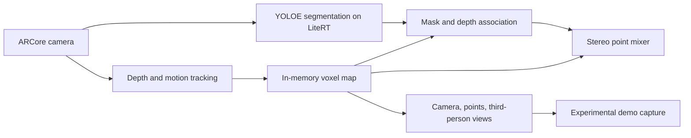

# Architecture

EchoSpace has two independent prototypes: an Android scanner and a browser simulator. They do not share a runtime or a server.

## Android data flow

1. `DepthScanActivity` obtains ARCore frames, samples depth, and stores points relative to a map anchor. It deduplicates points into voxels and thins the map at its size limit.
2. `LiveObjectDetector` sends a captured camera frame to the local LiteRT model. `SemanticAssociation` compares instance masks and corresponding depth with stored points. Two observations are required before a point receives a category.
3. `MapCorrection` compares visible stored points against fresh ARCore raw depth and confidence. Repeated clear-space observations remove contradicted points; hidden or unreliable observations do not. This does not establish persistent object identity.
4. `AudioPointSelector` chooses a bounded spatially distributed set of points. `AudioEngine` combines their phone-relative stereo contributions using shared noise and category sound generators, with distance fades. The hearing zone is horizontal range plus a height band relative to the phone.
5. OpenGL renders the camera, colored points, or a third-person projection. The experimental demo recorder attempts to render the same scan into three video streams and save a separate stereo audio recording.

The ARCore map and detector operate locally. The Android prototype does not implement a backend agent, room synchronization, or independent head tracking. Android media encoding, model accuracy and sustained performance need device testing.

## Browser simulator

`poc/src/world.ts` describes a synthetic environment. `engine.ts`, `selection.ts`, and `audio.ts` implement simulated scanning and sound; `App.tsx` contains controls. Object labels and recognition are simulated. Browser and Android audio use different implementations, so simulator results do not validate the mobile pipeline.

## Model data

The included teammate-supplied TFLite model has 18 embedded indoor classes and a segmentation output. Its metadata identifies Ultralytics and AGPL-3.0. An absolute local dataset path was redacted from the appended metadata before publication; the TFLite flatbuffer bytes and license field were left unchanged. See the root README for attribution.
